

  
  
  
  
  

<h1 align="center">🌐 Web3 Free Resources — The Ultimate Guide</h1>

  <strong>A curated, verified collection of 27+ free resources to learn Web3, Blockchain, Solidity, DeFi, and Smart Contract Development — from absolute zero to production-ready.</strong>

  <em>🇮🇳 Includes dedicated Hindi learning resources & YouTube channels</em>

---

## 📖 Table of Contents

- [🗺️ Web3 Learning Roadmap](#️-web3-learning-roadmap)
- [🏗️ Architecture Overview](#️-architecture-overview)
- [📚 Free Learning Resources (27+)](#-free-learning-resources-27)
  - [🔰 Foundations & Concepts](#-foundations--concepts)
  - [📝 Solidity & Smart Contracts](#-solidity--smart-contracts)
  - [🛠️ Development Frameworks & Tools](#️-development-frameworks--tools)
  - [🔗 L1 / L2 Ecosystem Documentation](#-l1--l2-ecosystem-documentation)
  - [🌉 Oracles, Indexing & Storage](#-oracles-indexing--storage)
  - [🏆 Challenges, CTFs & Hands-On Practice](#-challenges-ctfs--hands-on-practice)
  - [🎓 Full Courses & Bootcamps](#-full-courses--bootcamps)
- [🇮🇳 Hindi YouTube Resources](#-hindi-youtube-resources)
- [🧭 Ecosystem Map](#-ecosystem-map)
- [🛤️ 90-Day Learning Plan](#️-90-day-learning-plan)
- [🤝 Contributing](#-contributing)
- [📄 License](#-license)

---

## 🗺️ Web3 Learning Roadmap

> Follow this roadmap from top to bottom. Each phase builds on the previous one.

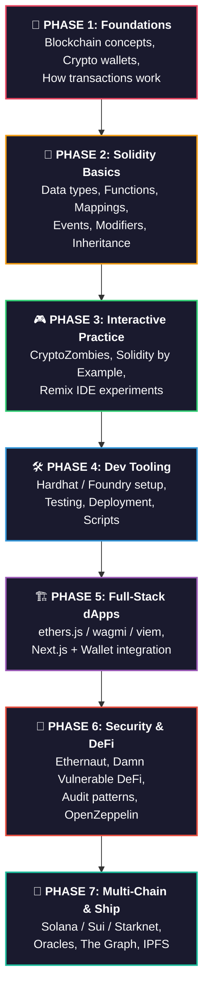

---

## 🏗️ Architecture Overview

> Understanding where each technology fits in the Web3 stack.

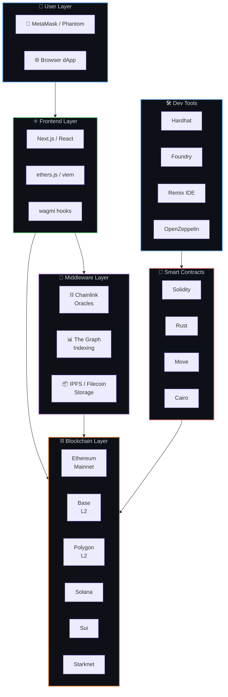

---

## 📚 Free Learning Resources (27+)

### 🔰 Foundations & Concepts

> Start here if you're brand new to blockchain and Web3.

| # | Resource | What You'll Learn | Best For | Link |
|:-:|----------|-------------------|----------|:----:|
| 1 | **Ethereum Learn Hub** | How blockchain works, consensus, wallets, gas, accounts | Absolute beginners | [🔗 Visit](https://ethereum.org/learn/) |
| 2 | **Ethereum Developer Tutorials** | Guided step-by-step tutorials for building dApps | Beginners ready to code | [🔗 Visit](https://ethereum.org/developers/tutorials) |

Optional reading (Simplified Chinese): [链小知区块链: Token approvals](https://lianxiaozhi.com/learn/token-approvals) explains ERC-20 allowances, disconnecting versus revoking, and checking the network, owner, spender and post-transaction allowance; free, source-linked and AI-assisted.

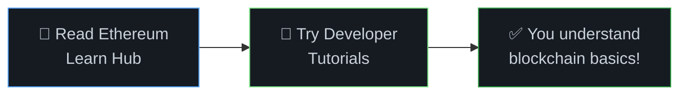

---

### 📝 Solidity & Smart Contracts

> The core language for Ethereum and EVM-compatible chains.

| # | Resource | What You'll Learn | Format | Link |
|:-:|----------|-------------------|--------|:----:|
| 3 | **Solidity Documentation** | Complete language reference — types, functions, assembly | Official docs | [🔗 Visit](https://docs.soliditylang.org/en/latest/) |
| 4 | **Solidity by Example** | 60+ short, copy-paste-ready Solidity patterns | Code snippets | [🔗 Visit](https://solidity-by-example.org/) |
| 5 | **Remix IDE** | Write, compile, deploy, and debug contracts in the browser | Browser IDE | [🔗 Visit](https://remix.ethereum.org/) |
| 6 | **CryptoZombies** | Learn Solidity by building a zombie game — interactive & fun | Interactive game | [🔗 Visit](https://cryptozombies.io/) |
| 7 | **OpenZeppelin Contracts + Wizard** | Battle-tested ERC-20, ERC-721, ERC-1155, access control | Library + generator | [🔗 Visit](https://docs.openzeppelin.com/contracts) |

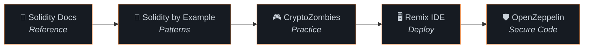

---

### 🛠️ Development Frameworks & Tools

> Professional toolchains for building, testing, and deploying smart contracts.

| # | Resource | What You'll Learn | Language | Link |
|:-:|----------|-------------------|----------|:----:|
| 8 | **Foundry** | Blazing-fast Solidity testing, fuzzing, scripting, local chains | Solidity-native | [🔗 Visit](https://www.getfoundry.sh/) |
| 9 | **Hardhat** | The most popular EVM development environment | JavaScript/TS | [🔗 Visit](https://hardhat.org/docs/getting-started) |
| 10 | **Scaffold-ETH 2** | Full-stack dApp starter — Next.js + Hardhat + wallet connect | Full-stack | [🔗 Visit](https://scaffoldeth.io/) |

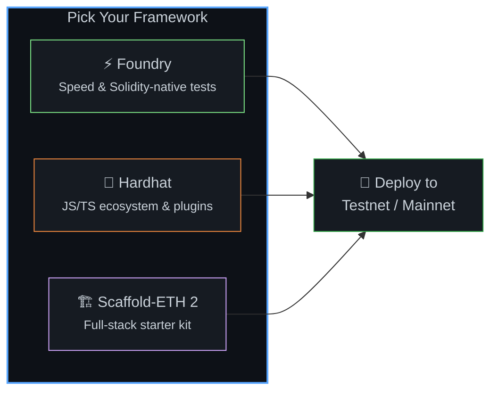

---

### 🔗 L1 / L2 Ecosystem Documentation

> Explore multiple blockchains — each with its own language and ecosystem.

| # | Resource | Blockchain | Language | Link |
|:-:|----------|------------|----------|:----:|
| 11 | **Base Developer Docs** | Base (Ethereum L2) | Solidity | [🔗 Visit](https://docs.base.org/get-started/base) |
| 12 | **Polygon dApp Launchpad** | Polygon (Ethereum L2) | Solidity | [🔗 Visit](https://docs.polygon.technology/tools/dApp-development/launchpad/quickstart) |
| 13 | **Solana Documentation** | Solana | Rust / Anchor | [🔗 Visit](https://solana.com/docs) |
| 14 | **Sui Documentation** | Sui | Move | [🔗 Visit](https://docs.sui.io/) |
| 15 | **The Move Book (Sui)** | Sui | Move | [🔗 Visit](https://examples.sui.io/) |
| 16 | **The Cairo Book** | Starknet | Cairo | [🔗 Visit](https://www.starknet.io/cairo-book/) |
| 17 | **Starknet Docs** | Starknet | Cairo | [🔗 Visit](https://docs.starknet.io/) |

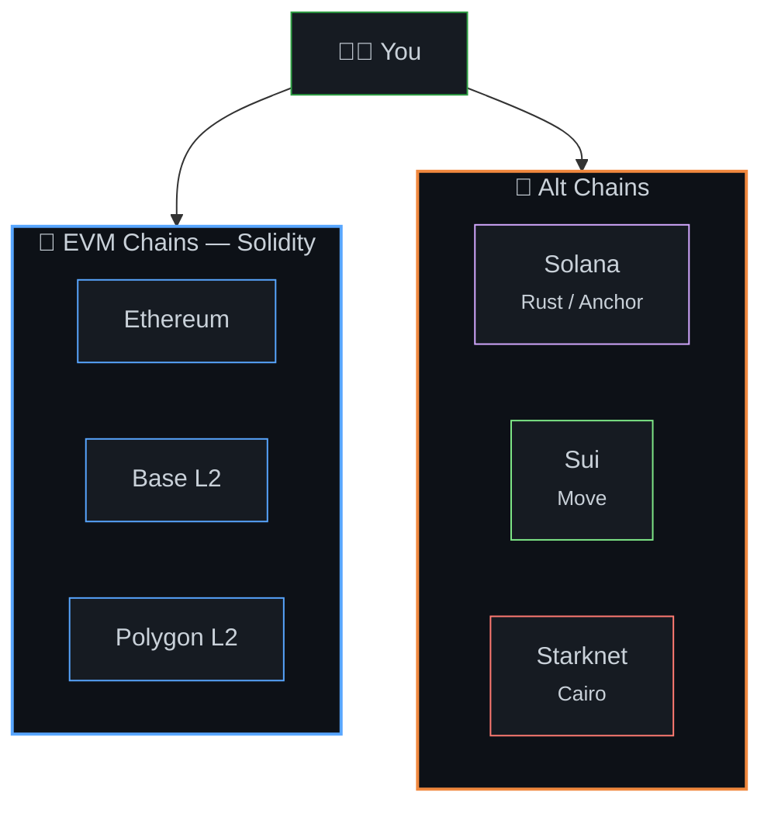

---

### 🌉 Oracles, Indexing & Storage

> Essential middleware for production-grade dApps.

| # | Resource | Purpose | What You'll Build | Link |
|:-:|----------|---------|-------------------|:----:|
| 18 | **Chainlink Developer Bootcamp** | Price feeds, VRF, Automation, CCIP | Oracle-powered dApps | [🔗 Visit](https://chain.link/bootcamp/on-demand) |
| 19 | **Chainlink Tutorials** | Step-by-step project guides | NFT marketplaces, cross-chain apps | [🔗 Visit](https://chain.link/tutorials) |
| 20 | **The Graph Academy** | Indexing on-chain data with subgraphs | Queryable blockchain data APIs | [🔗 Visit](https://thegraph.academy/course/the-graph-intro-course/) |
| 21 | **IPFS Documentation** | Decentralized file storage & hosting | Store NFT metadata, host dApps | [🔗 Visit](https://docs.ipfs.tech/) |

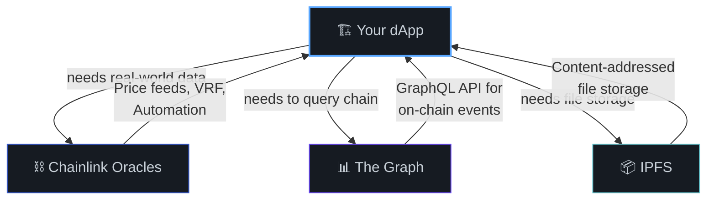

---

### 🏆 Challenges, CTFs & Hands-On Practice

> Level up by solving real security puzzles and building projects.

| # | Resource | Difficulty | What You'll Practice | Link |
|:-:|----------|:----------:|----------------------|:----:|
| 22 | **Ethernaut (OpenZeppelin)** | 🟡 Medium | Solidity vulnerabilities — reentrancy, overflow, access control | [🔗 Visit](https://ethernaut.openzeppelin.com/) |
| 23 | **Damn Vulnerable DeFi** | 🔴 Hard | DeFi exploit patterns — flash loans, governance attacks | [🔗 Visit](https://github.com/OpenZeppelin/damn-vulnerable-defi) |
| 24 | **Speedrun Ethereum** | 🟢 Easy-Med | Build & deploy real dApps — DEX, staking, NFTs | [🔗 Visit](https://speedrunethereum.com/) |
| 25 | **BuidlGuidl CTF** | 🟡 Medium | Solidity puzzles and pattern recognition | [🔗 Visit](https://ctf.buidlguidl.com/) |
| 26 | **Node Guardians** | 🟡 Medium | Quest-based learning with RPG-style progression | [🔗 Visit](https://nodeguardians.io/) |

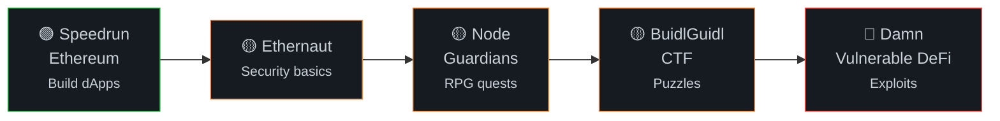

---

### 🎓 Full Courses & Bootcamps

> Structured, comprehensive courses that take you from zero to builder.

| # | Resource | Duration | What's Covered | Link |
|:-:|----------|:--------:|----------------|:----:|
| 27 | **Cyfrin Updraft** | 50+ hrs | Solidity, Foundry, DeFi, Security, Advanced patterns | [🔗 Visit](https://updraft.cyfrin.io/courses) |
| 28 | **freeCodeCamp × Patrick Collins (32hr)** | 32 hrs | Full-stack Web3 with JavaScript — contracts to frontend | [🔗 YouTube](https://www.youtube.com/watch?v=gyMwXuJrbJQ) |
| 29 | **Solana Developer Bootcamp 2026** | 12+ hrs | Solana programs, clients, full-stack crypto development | [🔗 YouTube](https://www.youtube.com/watch?v=2pcm7ICRJKU) |
| 30 | **Chainlink Bootcamp (On-Demand)** | 8+ hrs | Solidity + Chainlink oracles, VRF, automation | [🔗 Visit](https://chain.link/bootcamp/on-demand) |
| 31 | **LearnWeb3** | Self-paced | Track-based: Freshman → Senior, NFTs, DeFi | [🔗 Visit](https://learnweb3.xyz/) |
| 32 | **Uniswap Developer Guide** | Self-paced | DeFi protocol integration, swaps, liquidity pools | [🔗 Visit](https://developers.uniswap.org/docs/protocols/v2/guides/getting-started) |

---

## 🇮🇳 Hindi YouTube Resources

> **हिंदी में Web3 सीखें** — ये सभी verified channels और playlists हैं जो high-quality Hindi content provide करते हैं।

### 📺 Channel: Code Eater

> *India's most popular Hindi blockchain education channel with 100K+ subscribers.*

| # | Topic | Video / Playlist | Duration | Link |
|:-:|-------|------------------|:--------:|:----:|
| 1 | Blockchain fundamentals | Blockchain Full Course — 6 hours | ~6 hrs | [▶️ Watch](https://www.youtube.com/watch?v=6aF6p2VUORE) |
| 2 | Solidity programming | Solidity Programming Tutorial Hindi | ~4 hrs | [▶️ Watch](https://www.youtube.com/watch?v=NqGe942J4Y0) |
| 3 | Web3 frontend | web3.js Full Course Hindi | ~3 hrs | [▶️ Watch](https://www.youtube.com/watch?v=u3PtGMRmGA0) |
| 4 | Development tools | Hardhat Full Course Hindi | ~4 hrs | [▶️ Watch](https://www.youtube.com/watch?v=6SYsy1ZlOPo) |
| 5 | Project building | Solidity Project for Beginners | ~2 hrs | [▶️ Watch](https://www.youtube.com/watch?v=aFI_XPll_mg) |
| 6 | NFT development | NFT Full Course (Playlist) | Multi-part | [▶️ Watch](https://www.youtube.com/playlist?list=PLgPmWS2dQHW8AUns9PlkBW_vQsPr7fO9H) |
| 7 | Starknet & Cairo | Starknet & Cairo Introduction Hindi | ~1 hr | [▶️ Watch](https://www.youtube.com/watch?v=OmlsK_Wvzss) |

---

### 📺 Channel: web3Mantra

> *Comprehensive blockchain development tutorials in Hindi with project-based learning.*

| # | Topic | Video / Playlist | Duration | Link |
|:-:|-------|------------------|:--------:|:----:|
| 8 | Complete blockchain dev | Complete Blockchain Dev Course | ~8 hrs | [▶️ Watch](https://www.youtube.com/watch?v=RkYVVC2vXho) |
| 9 | Solidity deep dive | Solidity Full Course in Hindi (Playlist) | Multi-part | [▶️ Watch](https://www.youtube.com/playlist?list=PLR0uCBk15bq9a__TgfcZ7oA73MTEZ3NOK) |
| 10 | Real-world dApp | Web3 Crowdfunding dApp in Hindi | ~3 hrs | [▶️ Watch](https://www.youtube.com/watch?v=ls1Noh2b5Ms) |

---

### 📺 Channel: Pepcoding

> *Well-known Indian coding education platform with a dedicated Solidity playlist.*

| # | Topic | Video / Playlist | Duration | Link |
|:-:|-------|------------------|:--------:|:----:|
| 11 | Solidity 0.8 | Pepcoding Solidity in Hindi (Playlist) | Multi-part | [▶️ Watch](https://www.youtube.com/playlist?list=PL-Jc9J83PIiG6_thChXWzolj9BEG-Y0gh) |

---

### 📺 Bonus: Smart Contract Programmer (English)

> *Best for Solidity deep-dives — DeFi protocols, gas optimization, and patterns.*

| # | Topic | Link |
|:-:|-------|:----:|
| 12 | Solidity patterns, DeFi code walkthroughs, gas optimization | [▶️ Channel](https://www.youtube.com/@smartcontractprogrammer) |

---

### 🎯 Recommended Hindi Learning Path

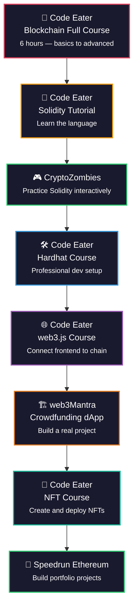

---

## 🧭 Ecosystem Map

> See how all the tools, chains, and protocols connect in the Web3 ecosystem.

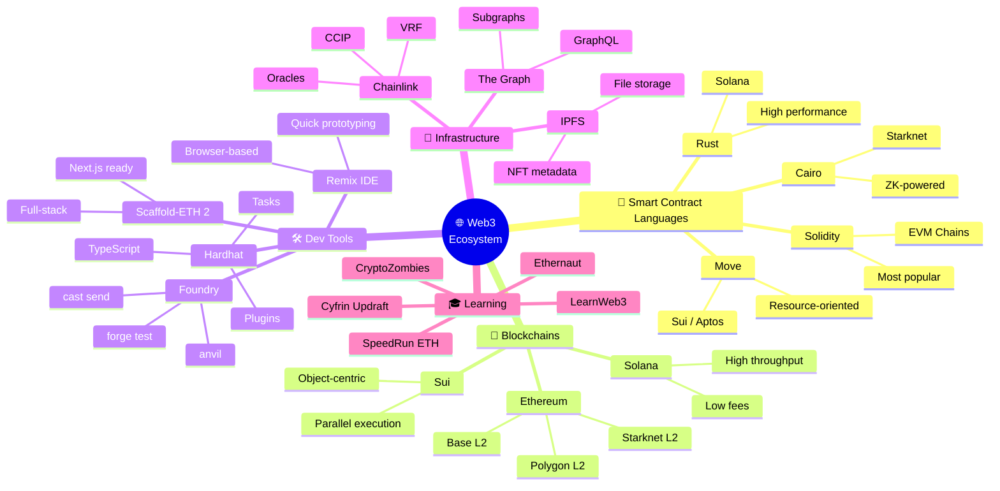

---

## 🛤️ 90-Day Learning Plan

> A structured plan to go from zero blockchain knowledge to building and deploying your own dApps.

### 📅 Month 1 — Foundations & Solidity

```mermaid
gantt
    title Month 1 — Foundations & Solidity
    dateFormat  X
    axisFormat %s

    section Week 1-2
    Ethereum Learn Hub & Concepts     :a1, 0, 14
    section Week 2-3
    Solidity Docs + Solidity by Example :a2, 7, 21
    section Week 3-4
    CryptoZombies (all levels)          :a3, 14, 28
    section Week 4
    Remix IDE — deploy first contract   :a4, 21, 28
```

| Week | Focus | Resources | Goal |
|:----:|-------|-----------|------|
| 1–2 | Blockchain fundamentals | Ethereum Learn Hub, Code Eater (6hr course) | Understand blocks, txns, gas, wallets |
| 2–3 | Solidity basics | Solidity Docs, Solidity by Example | Write functions, mappings, events |
| 3–4 | Interactive practice | CryptoZombies (all 6 lessons) | Build a complete game contract |
| 4 | First deployment | Remix IDE on Sepolia testnet | Deploy & verify your first contract |

---

### 📅 Month 2 — Tooling & Full-Stack

| Week | Focus | Resources | Goal |
|:----:|-------|-----------|------|
| 5–6 | Dev framework | Foundry or Hardhat (pick one) | Write tests, scripts, deploy locally |
| 6–7 | Frontend integration | ethers.js / wagmi, Code Eater web3.js course | Connect wallet, read/write contracts |
| 7–8 | Full-stack dApp | Scaffold-ETH 2 or Speedrun Ethereum | Build & deploy a working dApp |
| 8 | OpenZeppelin | Use OZ Contracts, ERC-20/721 Wizard | Create a token and an NFT |

---

### 📅 Month 3 — Security, DeFi & Beyond

| Week | Focus | Resources | Goal |
|:----:|-------|-----------|------|
| 9–10 | Smart contract security | Ethernaut (first 15 levels) | Identify common vulnerabilities |
| 10–11 | DeFi concepts | Uniswap Guide, Damn Vulnerable DeFi | Understand AMMs, flash loans |
| 11–12 | Middleware & multi-chain | Chainlink, The Graph, IPFS | Integrate oracles, indexing, storage |
| 12 | Portfolio project | Combine everything learned | Deploy a production-quality dApp |

---

## 📊 Resource Comparison Matrix

> Quick comparison to help you choose the right resource for your level.

| Resource | Beginner | Intermediate | Advanced | Interactive | Free | Has Hindi |
|----------|:--------:|:------------:|:--------:|:-----------:|:----:|:---------:|
| Ethereum Learn Hub | ✅ | ❌ | ❌ | ❌ | ✅ | ❌ |
| CryptoZombies | ✅ | ✅ | ❌ | ✅ | ✅ | ❌ |
| Solidity by Example | ✅ | ✅ | ❌ | ❌ | ✅ | ❌ |
| Cyfrin Updraft | ✅ | ✅ | ✅ | ✅ | ✅ | ❌ |
| Ethernaut | ❌ | ✅ | ✅ | ✅ | ✅ | ❌ |
| Damn Vulnerable DeFi | ❌ | ❌ | ✅ | ✅ | ✅ | ❌ |
| Speedrun Ethereum | ❌ | ✅ | ✅ | ✅ | ✅ | ❌ |
| Code Eater (YT) | ✅ | ✅ | ❌ | ❌ | ✅ | ✅ |
| web3Mantra (YT) | ✅ | ✅ | ✅ | ❌ | ✅ | ✅ |
| Patrick Collins 32hr | ✅ | ✅ | ❌ | ❌ | ✅ | ❌ |
| LearnWeb3 | ✅ | ✅ | ✅ | ✅ | ✅ | ❌ |
| Node Guardians | ❌ | ✅ | ✅ | ✅ | ✅ | ❌ |

---

## 🔑 Quick Reference: Key Concepts

```mermaid
graph LR
    subgraph CORE["Core Concepts"]
        direction TB
        BC["⛓️ Blockchain<br/><small>Immutable distributed ledger</small>"]
        SC["📜 Smart Contract<br/><small>Self-executing on-chain code</small>"]
        GAS["⛽ Gas<br/><small>Computation fee in ETH/GWEI</small>"]
        WALLET["👛 Wallet<br/><small>Public + Private key pair</small>"]
    end

    subgraph TOKENS["Token Standards"]
        direction TB
        E20["🪙 ERC-20<br/><small>Fungible tokens (USDC, UNI)</small>"]
        E721["🖼️ ERC-721<br/><small>NFTs — unique tokens</small>"]
        E1155["🎁 ERC-1155<br/><small>Multi-token standard</small>"]
    end

    subgraph DEFI["DeFi Primitives"]
        direction TB
        AMM["💱 AMM<br/><small>Automated Market Maker</small>"]
        LP["🏊 Liquidity Pool<br/><small>Token pairs for trading</small>"]
        FL["⚡ Flash Loan<br/><small>Uncollateralized instant loan</small>"]
    end

    CORE ~~~ TOKENS ~~~ DEFI

    style CORE fill:#0d1117,stroke:#58a6ff,color:#c9d1d9,stroke-width:2px
    style TOKENS fill:#0d1117,stroke:#7ee787,color:#c9d1d9,stroke-width:2px
    style DEFI fill:#0d1117,stroke:#d2a8ff,color:#c9d1d9,stroke-width:2px
    style BC fill:#161b22,stroke:#58a6ff,color:#c9d1d9
    style SC fill:#161b22,stroke:#58a6ff,color:#c9d1d9
    style GAS fill:#161b22,stroke:#58a6ff,color:#c9d1d9
    style WALLET fill:#161b22,stroke:#58a6ff,color:#c9d1d9
    style E20 fill:#161b22,stroke:#7ee787,color:#c9d1d9
    style E721 fill:#161b22,stroke:#7ee787,color:#c9d1d9
    style E1155 fill:#161b22,stroke:#7ee787,color:#c9d1d9
    style AMM fill:#161b22,stroke:#d2a8ff,color:#c9d1d9
    style LP fill:#161b22,stroke:#d2a8ff,color:#c9d1d9
    style FL fill:#161b22,stroke:#d2a8ff,color:#c9d1d9
```

---

## 🤝 Contributing

Found a broken link or want to add a resource? Contributions are welcome!

1. **Fork** this repository
2. **Add** your resource to the appropriate section
3. **Verify** the link is working and the resource is genuinely free
4. **Submit** a Pull Request

### Contribution Guidelines

- ✅ Resource must be **100% free** (no paywalled content)
- ✅ Resource must be **actively maintained** (updated within the last 12 months)
- ✅ Include a brief description of what the resource teaches
- ✅ Hindi resources should be clearly marked with 🇮🇳

---

## 📄 License

This resource list is released under the [MIT License](LICENSE). Share it freely! 🚀

---

  <strong>⭐ If this helped you, give it a star!</strong> 
  <em>Built with ❤️ for the Web3 community</em>  
  
  

